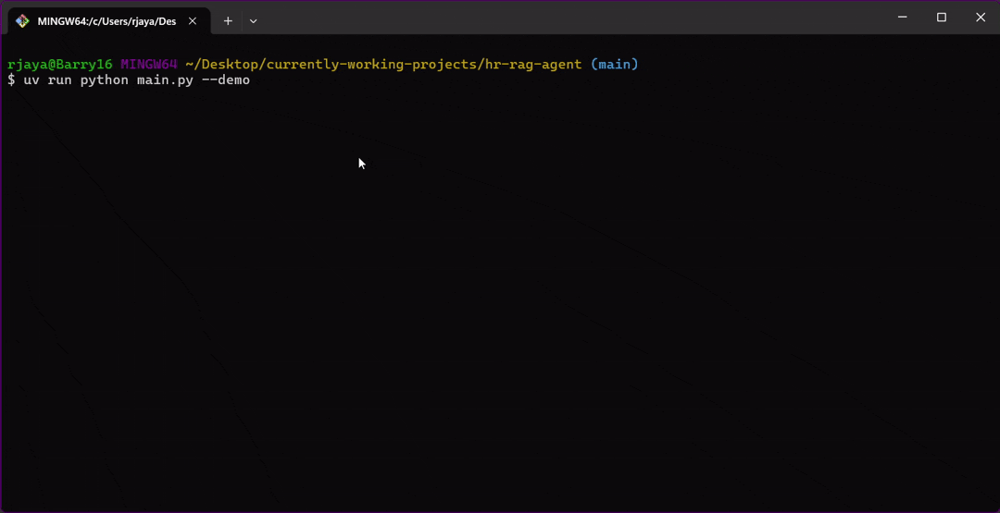

# Agentic Enterprise RAG Assistant

An edge-inference AI assistant designed to automate backend workflows. It routes natural language queries to local databases using a Retrieval-Augmented Generation (RAG) pipeline and structured JSON-schema tool calling. Built for fully offline execution to ensure 100% data privacy.


## Architecture

- **Inference Engine:** LM Studio (Local Edge Execution)
- **Vector Database:** ChromaDB (Semantic Document Search)
- **Relational Database:** SQLite (Transactional Data Handling)
- **Routing:** JSON-schema tool-calling mapped to Python functions

## Project Structure

```text
├── main.py                  # Application entry point
├── config.py                # Inference and environment variables
├── requirements.txt         # Project dependencies
├── data/                    # CSV datasets (Relational & Vector data)
├── database/                # SQLite and ChromaDB access layer
└── agent/                   # LLM orchestration loop and tool schemas

```

## Quick Start

**1. Install dependencies (uv)**

```bash
uv venv && uv pip install -e ".[dev]"
cp .env.example .env
```

**2. Start Local Inference**
Open LM Studio, load a model optimized for function calling (e.g., Qwen 2.5), and start the Local Server on `http://localhost:1234/v1`.

**3. Run the Agent**

```bash
uv run python main.py            # interactive
uv run python main.py "my query" # one-shot
uv run pytest                    # tests
```

## Execution Flow

1. **Semantic Routing:** User queries regarding policies map to `vector_search_hr_policy` and execute against ChromaDB.
2. **Action Routing:** Actionable requests (e.g., booking time off) trigger LLM payload extraction, passing arguments to `submit_leave_request` for SQLite database updates.
3. **Validation:** Agent dynamically handles missing arguments by halting execution and prompting the user for required parameters (e.g., specific dates).

