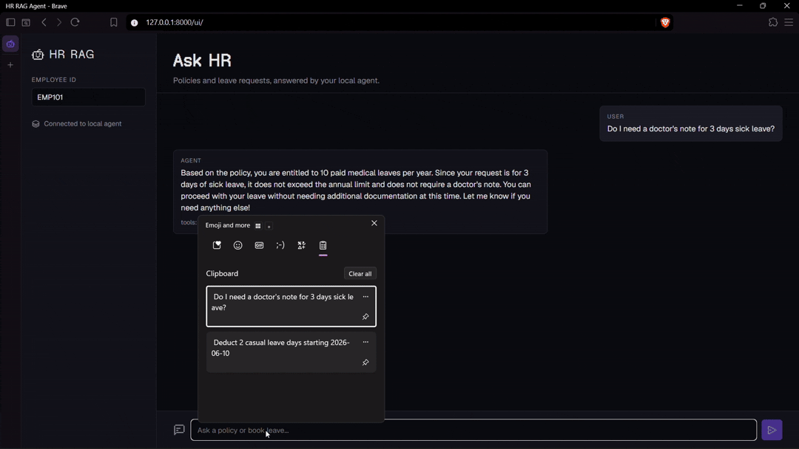

# Agentic Enterprise RAG Assistant

A local HR assistant that answers policy questions with retrieval-augmented generation and books leave through structured tool calls. Runs fully offline against LM Studio.




## What it does

- Answers HR policy questions (leave, WFH, holidays, allowances) from ChromaDB.
- Books or deducts leave in SQLite when asked, after checking balances.
- Asks for missing details instead of guessing.

## Architecture

- Inference: LM Studio (OpenAI-compatible local server)
- Vector store: ChromaDB over `data/hr_policies.csv`
- Relational store: SQLite (`enterprise_hr.db`)
- Orchestration: JSON-schema tool calling in `agent/`

## Project structure

```text
main.py                  # CLI entry point
config.py                # Environment and paths
agent/                   # LLM loop and tool schemas
database/                # SQLite and ChromaDB access
data/                    # Seed CSVs
tests/                   # pytest suite
eval/                    # Eval cases and runner
ui/                      # Web UI
api.py                   # FastAPI wrapper
```

## Quick start

1. Install dependencies:

```bash
uv venv && uv pip install -e ".[dev]"
cp .env.example .env
```

2. Start LM Studio, load a function-calling model, and start the server on `http://localhost:1234/v1`.
3. Initialize data and run:

```bash
uv run python main.py
```

One-shot query:

```bash
uv run python main.py "How many casual leaves do I get?"
```

Demo flow:

```bash
uv run python main.py --demo
```

## Web UI and API

Run the API:

```bash
uv run uvicorn api:app --reload
```

Open `ui/index.html` or serve the `ui/` folder. The UI calls the API on `http://localhost:8000`.

## Docker

```bash
docker compose up --build
```

## Tests

```bash
uv run pytest
```

## Evaluation

Run the eval harness:

```bash
uv run python eval/run_eval.py
```

Results are written to `eval/results.json`.

Current results (9/9 passing):

| Area | Case | Tool match | Answer match |
|---|---|---|---|
| Policy | doctor note for sick leave | yes | yes |
| Policy | casual leave count | yes | yes |
| Policy | work from home | yes | yes |
| Policy | maternity leave | yes | yes |
| Policy | paternity leave | yes | yes |
| Action | deduct casual leave | yes | yes |
| Action | book medical leave | yes | yes |
| Action | insufficient balance | yes | yes |
| Missing args | ask for required fields | yes | yes |

## Configuration

All settings come from `.env` (see `.env.example`):

- `LLM_BASE_URL`, `API_KEY`, `MODEL_NAME`
- `SQL_DB_PATH`, `VECTOR_DB_PATH`
- `EMPLOYEES_CSV_PATH`, `POLICIES_CSV_PATH`

## Notes

- `enterprise_hr.db` and `chroma_hr_db/` are generated at setup and are gitignored.
- The agent refuses leave types it does not support and reports insufficient balances.
